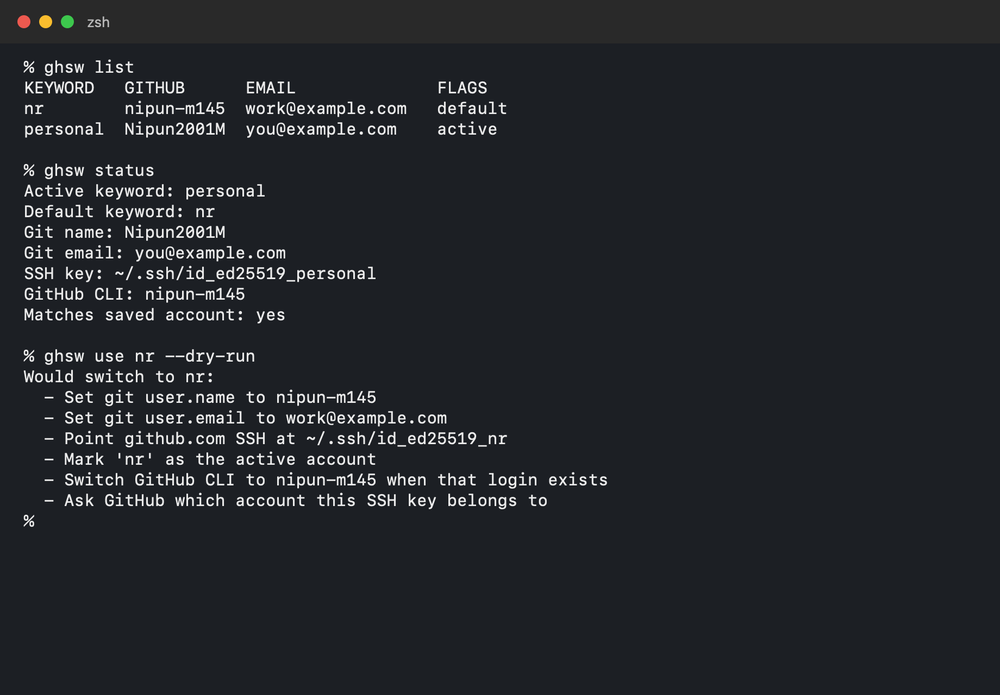

# Use the command line

`ghsw` is the terminal command. These examples match the two accounts on this Mac: `personal` is active, and `nr` is the default.

Email addresses in the picture are examples.



## See what is active

```bash
ghsw list
ghsw status
```

`list` shows every keyword. `status` shows the Git name, Git email, SSH key, and GitHub CLI user that the next commit and push will use.

## Preview a switch

```bash
ghsw use nr --dry-run
```

This prints what would change and writes nothing.

## Switch

```bash
ghsw use personal
ghsw use nr
ghsw use
```

`ghsw use` with no keyword activates the default account.

A switch updates:

- Git `user.name` and `user.email`
- The `github.com` block in `~/.ssh/config`
- The active GitHub CLI login, when that username is already logged in

## Other commands

```bash
ghsw add personal
ghsw default personal
ghsw key personal
ghsw remove personal
```

`ghsw key` prints that account's public SSH key so you can copy it to GitHub. `ghsw remove` forgets the keyword. It does not delete the key file.

Add an account without prompts:

```bash
ghsw add personal \
  --username Nipun2001M \
  --name "Nipun2001M" \
  --email you@example.com \
  --ssh-key ~/.ssh/id_ed25519_personal \
  --generate-key
```
