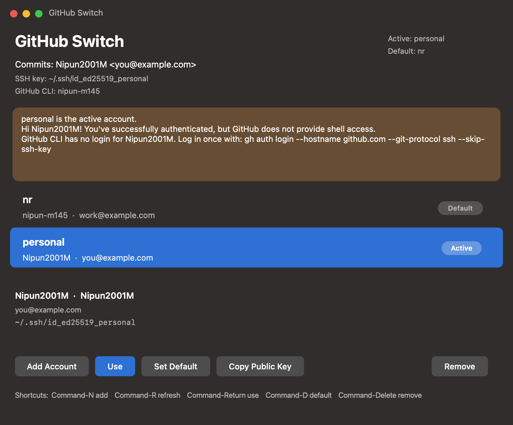
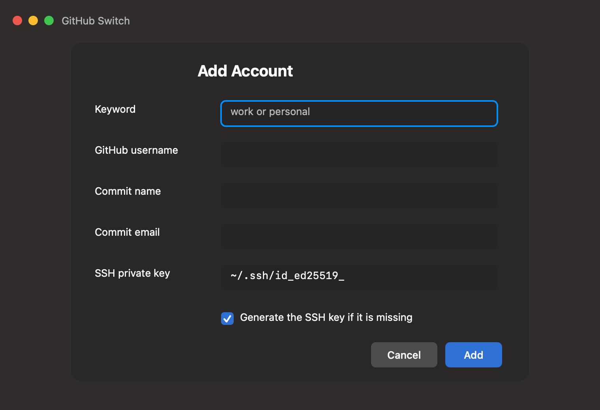

# Use the app

Open **GitHub Switch** from Spotlight or the Applications folder.

Email addresses in the picture are examples.

## What the window shows

- **Active** is the account in use now. In the picture that is `personal`.
- **Default** is the account `ghsw use` picks when you do not type a keyword. In the picture that is `nr`.
- **Commits** is the name and email Git will put on the next commit.
- **SSH key** is the private key used for `github.com`.
- **GitHub CLI** is the account `gh` is logged in as.
- The brown note is the result of the last switch. Here the SSH key was accepted, and GitHub CLI still needs a login for `Nipun2001M`.

Each row is one saved account. **Active** and **Default** mark the current ones. The lines under the list are the selected account.

## Buttons

| Button | What it does |
| --- | --- |
| Add Account | Save another GitHub account. Same form as Command-N. |
| Use | Make the selected account active. |
| Set Default | Use this account when you run `ghsw use` with no keyword. |
| Copy Public Key | Show the public key to paste into GitHub. |
| Remove | Forget the keyword. The key file stays on this Mac. |

## Keyboard shortcuts

| Action | Shortcut |
| --- | --- |
| Add an account | Command-N |
| Refresh | Command-R |
| Use the selected account | Command-Return |
| Set the selected account as the default | Command-D |
| Remove the selected account | Command-Delete |

You can also right-click a row for Use, Set as Default, Copy Public Key, and Remove.

## Add an account

Click **Add Account**. The form is covered in [Setup](setup.md).

